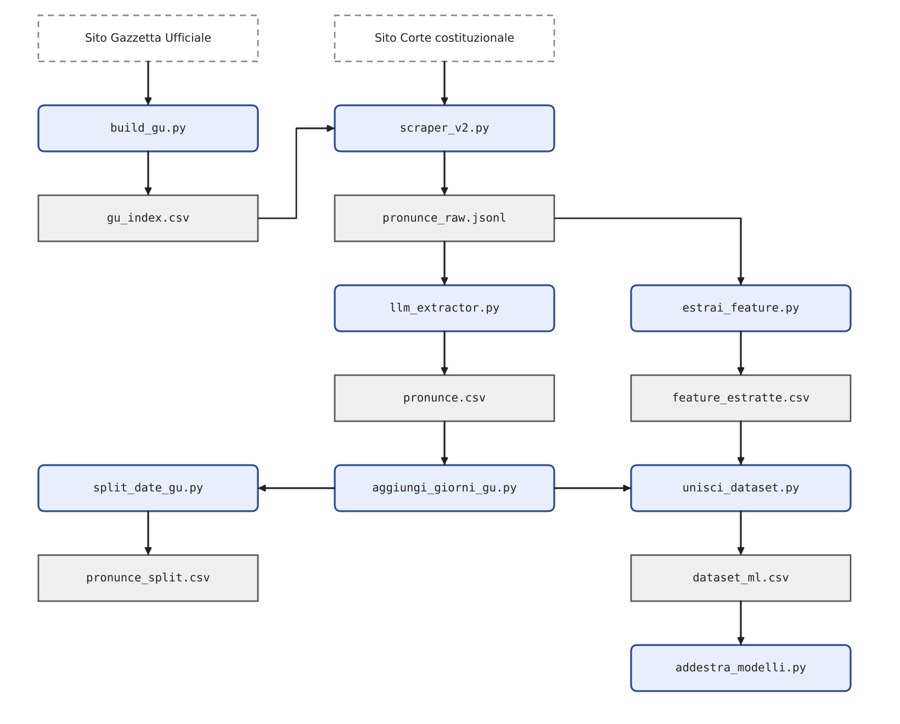

# Pronunce della Corte costituzionale: dataset e modelli predittivi

Sistema sviluppato durante il tirocinio e descritto nella tesi di laurea di Gioele D'Ovidio,
*Sistema automatizzato per l'acquisizione e l'analisi predittiva delle pronunce della
Corte Costituzionale italiana* (Università degli Studi di Modena e Reggio Emilia,
Corso di Laurea in Informatica, A.A. 2025/2026; relatore Prof. Angelo Ferrando).
Raccoglie dal sito della Corte costituzionale le pronunce emesse nei **giudizi di
legittimità costituzionale in via incidentale** (1956–2026) e produce:

1. il **dataset delle pronunce** (`pronunce.csv`, 16.672 righe): metadati, date di
   pubblicazione in Gazzetta Ufficiale delle ordinanze di rimessione, durata del
   procedimento, esito, giudice rimettente e parti costituite. È il prodotto principale,
   pensato per l'analisi giuridica;
2. il **dataset per l'apprendimento automatico** (`dataset_ml.csv`, 4.793 righe, anni
   2000–2026): caratteristiche strutturali di ogni questione estratte dal testo con un
   modello linguistico, insieme all'esito e alla durata;
3. **modelli predittivi** (gradient boosting) che stimano l'esito di una questione e la
   durata del giudizio, con il codice per valutarli e analizzarli.

La repository contiene tutto il codice e i dati finali: i modelli si possono rieseguire
subito, senza ripetere le fasi lente (scraping ed estrazione con LLM).

---

## Indice

1. [Contenuto della repository](#1-contenuto-della-repository)
2. [La pipeline](#2-la-pipeline)
3. [Requisiti](#3-requisiti)
4. [Installazione](#4-installazione)
5. [Esecuzione passo per passo](#5-esecuzione-passo-per-passo)
6. [Da dove partire](#6-da-dove-partire)
7. [I dati](#7-i-dati)
8. [I modelli predittivi](#8-i-modelli-predittivi)
9. [Riproducibilità e limiti](#9-riproducibilità-e-limiti)
10. [Corrispondenza con la tesi](#10-corrispondenza-con-la-tesi)
11. [Uso responsabile](#11-uso-responsabile)

---

## 1. Contenuto della repository

```
REPO/
├── README.md                     questo file
├── requirements.txt              librerie Python con le versioni usate
├── .gitignore
├── docs/
│   └── schema_pipeline.png       flusso dei dati tra gli script (Figura 3.1 della tesi)
├── pipeline/                     cartella di lavoro: script + dati (si lancia tutto da qui)
│   ├── build_gu.py               1  indice dei fascicoli della Gazzetta Ufficiale
│   ├── scraper_v2.py             2  scraping delle pronunce
│   ├── llm_extractor.py          3  giudice rimettente e parti costituite (LLM locale)
│   ├── aggiungi_giorni_gu.py     4  durata del procedimento
│   ├── split_date_gu.py          5  una riga per ordinanza (facoltativo)
│   ├── estrai_feature.py         6  feature per il machine learning (LLM cloud)
│   ├── unisci_dataset.py         7  dataset per il machine learning
│   ├── addestra_modelli.py       8a modelli: configurazione iniziale
│   ├── addestra_modelli_2.py     8b modelli: configurazione rivista
│   ├── addestra_modelli_3.py     8c analisi del modello (ablation, split casuale)
│   │
│   ├── gu_index.csv              dati prodotti dalla pipeline (versioni finali, usate nella tesi)
│   ├── pronunce.csv
│   ├── pronunce_split.csv
│   ├── feature_estratte.jsonl
│   ├── feature_estratte.csv
│   └── dataset_ml.csv
└── risultati/                    output dei tre script dei modelli sui dati inclusi
    ├── output_addestra_modelli.txt
    ├── output_addestra_modelli_2.txt
    └── output_addestra_modelli_3.txt
```

Ogni script è un programma autonomo: legge i file prodotti dagli script precedenti e
scrive il proprio risultato nella stessa cartella. Non c'è un programma principale; il
coordinamento avviene attraverso i file, e ogni stadio si può rieseguire da solo.

**Non incluso:** `pronunce_raw.jsonl`, l'archivio grezzo con il testo integrale delle
pronunce (centinaia di MB). Si rigenera con `scraper_v2.py` (passo 2) ed è necessario
solo per rieseguire i passi 3 e 6.

---

## 2. La pipeline



| # | Script | Legge | Produce | Richiede |
|---|---|---|---|---|
| 1 | `build_gu.py` | sito della Gazzetta Ufficiale | `gu_index.csv` | Chrome |
| 2 | `scraper_v2.py` | sito della Corte, `gu_index.csv` | `pronunce_raw.jsonl` | Chrome |
| 3 | `llm_extractor.py` | `pronunce_raw.jsonl` | `pronunce.csv` | Ollama + Qwen2.5 7B |
| 4 | `aggiungi_giorni_gu.py` | `pronunce.csv` | `pronunce.csv` (+ colonna `Giorni_GU_Decisione`) | — |
| 5 | `split_date_gu.py` | `pronunce.csv` | `pronunce_split.csv` | — |
| 6 | `estrai_feature.py` | `pronunce_raw.jsonl` | `feature_estratte.jsonl`, `feature_estratte.csv` | chiave API Gemini |
| 7 | `unisci_dataset.py` | `feature_estratte.csv`, `pronunce.csv` | `dataset_ml.csv` | — |
| 8 | `addestra_modelli*.py` | `dataset_ml.csv` | metriche a video | — |

Dall'archivio `pronunce_raw.jsonl` partono due rami:

- **ramo del dataset delle pronunce** (passi 3–5): metadati e campi estratti dal modello
  linguistico, completati con la durata. Il passo 5 è facoltativo: produce una versione
  con una riga per ogni ordinanza di rimessione, utile per le analisi giuridiche ma non
  usata dai modelli;
- **ramo del machine learning** (passi 6–8): feature estratte dal testo, unione con i
  valori da prevedere (esito e durata, presi da `pronunce.csv`), addestramento dei modelli.

---

## 3. Requisiti

| Componente | Serve per | Note |
|---|---|---|
| **Python 3.13** | tutto | sviluppato su Windows 11 |
| **Google Chrome** | passi 1–2 | `undetected-chromedriver` deve usare un driver della stessa versione principale del browser: il valore `version_main=153` in `build_gu.py` e `scraper_v2.py` **va aggiornato** alla versione di Chrome installata (`chrome://version`) |
| **[Ollama](https://ollama.com)** con il modello **Qwen2.5 7B** | passo 3 | il modello gira in locale; Ollama espone un'API compatibile con OpenAI su `http://localhost:11434/v1` |
| **Chiave API di Google Gemini** | passo 6 | modello `gemini-2.5-flash`; la chiave si legge dalla variabile d'ambiente `GOOGLE_API_KEY` e non compare mai nel codice |

I passi 4, 5, 7 e 8 richiedono solo Python e le librerie di `requirements.txt`.

---

## 4. Installazione

```bash
# 1. ambiente virtuale
python -m venv .venv
.venv\Scripts\activate            # Windows   (Linux/macOS: source .venv/bin/activate)

# 2. librerie
pip install -r requirements.txt

# 3. solo per il passo 3: modello locale
ollama pull qwen2.5:7b             # Ollama deve essere in esecuzione

# 4. solo per il passo 6: chiave API di Gemini
set GOOGLE_API_KEY=la-tua-chiave           # Windows cmd
$env:GOOGLE_API_KEY="la-tua-chiave"        # Windows PowerShell
export GOOGLE_API_KEY=la-tua-chiave        # Linux/macOS
```

Tutti i comandi seguenti si lanciano **dalla cartella `pipeline/`**:

```bash
cd pipeline
```

---

## 5. Esecuzione passo per passo

Tutti gli script che lavorano a lungo sono **riprendibili**: all'avvio leggono il proprio
file di output e saltano ciò che è già stato elaborato. Un'esecuzione interrotta
(anche con `Ctrl+C`) riprende dal punto in cui si era fermata.

### Passo 1 — Indice della Gazzetta Ufficiale

```bash
python build_gu.py                 # tutti gli anni 1956-2026
python build_gu.py 2024            # un solo anno
python build_gu.py 2020 2024       # un intervallo
```

Costruisce `gu_index.csv` (colonne `numero, anno, data`): la tabella che converte il
numero di un fascicolo della Gazzetta nella sua data. Serve allo scraper per le
pronunce che citano la Gazzetta solo per numero ("n. 72 dell'anno 1976"). Usa due
archivi: quello storico (1956–1985) e quello della 1ª Serie Speciale (dal 1986).

### Passo 2 — Scraping delle pronunce

```bash
python scraper_v2.py               # tutti gli anni
python scraper_v2.py 2024          # un solo anno
python scraper_v2.py 2020 2024     # un intervallo
```

Usa il motore di ricerca del sito della Corte, filtrato sul giudizio in via
incidentale, e per ogni pronuncia salva in `pronunce_raw.jsonl` i metadati (numero,
tipo, date di camera di consiglio, decisione e deposito, esito, comunicato), le date GU
delle ordinanze di rimessione (`Date_GU`, con le eventuali anomalie in `Note_GU`) e il
testo integrale (`testo`).

- **CAPTCHA:** se il sito presenta una verifica anti-bot, lo script si ferma e chiede di
  risolverla nel browser e premere INVIO nel terminale. Non la aggira in automatico.
- Le pause tra le richieste mantengono un ritmo di navigazione paragonabile a quello di
  una persona: lo scraping completo richiede molte ore.

### Passo 3 — Giudice rimettente e parti costituite

```bash
python llm_extractor.py                  # elabora le pronunce non ancora in pronunce.csv
python llm_extractor.py --test 10        # prova sulle prime 10 nuove pronunce
python llm_extractor.py --rifai-vuoti    # rielabora le righe con Giudice vuoto
python llm_extractor.py --solo-filtri    # applica i controlli al CSV esistente, senza LLM
```

Manda a Qwen2.5 7B (via Ollama) l'intestazione di ogni pronuncia e ne estrae il
**giudice rimettente** e i **soggetti costituiti**. Una post-elaborazione deterministica
toglie gli intervenienti (Presidente del Consiglio, Avvocatura dello Stato) e verifica
che il giudice contenga il nome di un'autorità giudiziaria, altrimenti ritenta con un
prompt dedicato. Scrive `pronunce.csv` (separatore `;`), salvando ogni 10 pronunce.

### Passo 4 — Durata del procedimento

```bash
python aggiungi_giorni_gu.py --csv pronunce.csv
```

Aggiunge a `pronunce.csv` la colonna `Giorni_GU_Decisione`: i giorni tra la
pubblicazione in Gazzetta dell'ordinanza di rimessione e la decisione. Se una pronuncia
riunisce più ordinanze (più date in `Date_GU`), usa la **più remota**. Se manca una
delle due date, il campo resta vuoto.

### Passo 5 — Una riga per ordinanza (facoltativo)

```bash
python split_date_gu.py --csv pronunce.csv --output pronunce_split.csv
```

Crea una riga per ogni data GU, cioè per ogni ordinanza di rimessione, ripetendo gli
altri campi. Non è usato dai modelli.

### Passo 6 — Feature per il machine learning

```bash
python estrai_feature.py --test 10       # prova sulle prime 10 pronunce
python estrai_feature.py --dal 2000      # pronunce dal 2000 in poi (come nella tesi)
python estrai_feature.py --anno 2024     # un solo anno
python estrai_feature.py --range 2000 2010
```

Per ogni pronuncia taglia il testo **prima del "Considerato in diritto"** (resta la
descrizione della questione, non la decisione: così si evita il *data leakage*) e chiede
a Gemini 2.5 Flash sei caratteristiche con **vocabolario chiuso**, imposto da uno schema
Pydantic tramite l'output strutturato:

| Feature | Tipo |
|---|---|
| `tipo_atto_impugnato` | lista di etichette (legge statale, legge regionale, decreto-legge, …) |
| `autorita_rimettente_tipo` | etichetta (tribunale ordinario, Cassazione, TAR, …) |
| `giurisdizione_a_quo` | etichetta (penale, civile, amministrativa, tributaria, contabile, …) |
| `parametri_costituzionali` | lista di articoli della Costituzione |
| `parametri_interposti` | lista (CEDU, diritto UE, legge costituzionale, altro trattato) |
| `materia` | etichetta (20 materie) |

I parametri costituzionali sono controllati anche con un'espressione regolare
indipendente: i casi in cui i due metodi non concordano sono segnalati nel campo
`parametri_mismatch` del JSONL. Configurazione in testa allo script: `PROVIDER`
(`gemini` / `groq` / `openai`), `MODEL`, `MAX_WORKERS`, `REQ_PER_SEC` (da abbassare in
caso di errori di quota).

### Passo 7 — Dataset per il machine learning

```bash
python unisci_dataset.py
```

Unisce `feature_estratte.csv` e `pronunce.csv` sull'URL della pronuncia e costruisce i
due valori da prevedere:

- **esito**, ridotto a quattro classi (accoglimento, infondatezza, inammissibilità,
  altro) con parole chiave sul dispositivo;
- **durata**, la colonna `Giorni_GU_Decisione`.

Le pronunce con **esito misto** (es. "inammissibile – non fondata", cioè questioni
diverse decise in modo diverso) vengono **escluse**: le feature descrivono la pronuncia
nel suo insieme e attribuirle un solo esito richiederebbe una regola arbitraria. Sono 778
su 5.571.

### Passo 8 — Modelli predittivi

```bash
python addestra_modelli.py         # configurazione iniziale            (~1 minuto)
python addestra_modelli_2.py       # configurazione rivista             (alcuni minuti)
python addestra_modelli_3.py       # ablation e split casuale/temporale (alcuni minuti)
```

Vedi la [sezione 8](#8-i-modelli-predittivi).

---

## 6. Da dove partire

I dati finali sono già nella cartella `pipeline/`, quindi non serve rieseguire tutto.

| Obiettivo | Comandi | Servono |
|---|---|---|
| Rieseguire solo i modelli | passo 8 | solo Python |
| Cambiare il modo in cui si costruisce l'esito o il dataset ML | passi 7 → 8 | solo Python |
| Ricalcolare durate o righe per ordinanza | passi 4, 5 | solo Python |
| Aggiungere un anno nuovo (es. 2027) | passi 1, 2 sull'anno → 3 → 4 → 6 sull'anno → 7 → 8 | Chrome, Ollama, Gemini |
| Ricostruire tutto da zero | passi 1 → 8 | Chrome, Ollama, Gemini, molte ore |

Grazie alla ripresa automatica, per un anno nuovo gli script elaborano solo le pronunce
che mancano.

---

## 7. I dati

### `gu_index.csv` — 3.168 fascicoli (1956–2026)
`numero`, `anno`, `data` (gg/mm/aaaa).

### `pronunce.csv` — 16.672 pronunce (1956–2026), separatore `;`

| Colonna | Contenuto |
|---|---|
| `Numero_Pronuncia`, `Anno` | identificativo della pronuncia |
| `Date_GU` | date di pubblicazione in Gazzetta delle ordinanze di rimessione, separate da ` - `; in alcuni casi un'annotazione esplicita (es. "non in indice") |
| `Camera_Consiglio` | data della camera di consiglio o dell'udienza pubblica |
| `Decisione_del`, `Deposito_del` | data della decisione e del deposito |
| `Giorni_GU_Decisione` | durata in giorni (passo 4) |
| `Esito` | dispositivo, così come riportato sul sito |
| `Giudice` | giudice rimettente (LLM) |
| `Soggetto_Costituisce` | parti costituite, o `NO` (LLM) |
| `Comunicato` | `SI` se la Corte ha pubblicato un comunicato stampa |
| `URL_Pronuncia` | scheda della pronuncia sul sito della Corte: chiave di tutti i join |

### `pronunce_split.csv` — 24.900 righe
Stesse colonne, una riga per ogni ordinanza di rimessione (passo 5).

### `feature_estratte.jsonl` / `feature_estratte.csv` — 5.571 pronunce (2000–2026)
Le sei feature del passo 6. Il JSONL contiene anche i campi di controllo
(`parametri_regex`, `parametri_mismatch`) ed è il file usato per la ripresa.

### `dataset_ml.csv` — 4.793 pronunce (2000–2026), separatore `,`
Le sei feature + `data_gu` (prima data GU), `giorni_gu_decisione` ed `esito`
(1.845 inammissibilità, 1.642 infondatezze, 751 accoglimenti, 555 altro).

Le colonne di `pronunce.csv` che descrivono fatti successivi alla decisione
(`Comunicato`, date di decisione e deposito, …) **non** sono usate come feature: sarebbe
*data leakage*. Da quel file si prendono solo i valori da prevedere.

---

## 8. I modelli predittivi

Due compiti: **esito** (classificazione) e **durata** (regressione sul logaritmo dei
giorni). Algoritmo: gradient boosting su alberi di decisione
(`HistGradientBoostingClassifier` / `Regressor` di scikit-learn). Le pronunce sono
descritte da **117 colonne** binarie o numeriche (one-hot e multi-hot delle feature, una
colonna per ogni articolo della Costituzione presente in almeno 10 pronunce di training,
numero di parametri). L'anno **non** è una feature.

**Divisione temporale:** training sulle pronunce fino al 2022, test su quelle dal 2023
(`ANNO_TEST_DA` in `addestra_modelli.py`). Ogni modello è confrontato con una baseline
che ignora le feature: la classe più frequente per l'esito, la mediana per la durata.

| Script | Cosa fa |
|---|---|
| `addestra_modelli.py` | **configurazione iniziale**: esito a 4 classi, class weight bilanciati, iperparametri fissati a priori |
| `addestra_modelli_2.py` | **configurazione rivista**: esito a 3 classi (esclusa `altro`), recency weight e class weight attenuati, baseline sugli ultimi 3 anni, iperparametri scelti con una **rolling-origin validation** (finestre 2018–2022) |
| `addestra_modelli_3.py` | **analisi** del modello rivisto: *ablation study* per gruppi di feature e confronto tra split casuale e temporale |

> **Attenzione:** `addestra_modelli_3.py` usa gli iperparametri scelti da
> `addestra_modelli_2.py`, riportati a mano nelle costanti `PARAMS_ESITO` e
> `PARAMS_DURATA`. Se si riesegue la configurazione rivista e la validation sceglie
> valori diversi (riga `-> scelto:` nell'output), le costanti vanno aggiornate.

### Risultati sui dati inclusi (test 2023–2026)

| | Configurazione iniziale | Configurazione rivista |
|---|---|---|
| Esito: classi | 4 | 3 |
| Esito: F1 macro (baseline) | 0,321 (0,095) | 0,425 (0,133) |
| Esito: accuracy | 0,398 | 0,430 |
| Durata: MAE in giorni (baseline) | 92,0 (77,1) | 86,1 (77,1) |

Gli output completi (report per classe, matrici di confusione, importanza delle feature,
griglia di validation, ablation) sono in `risultati/`. L'analisi dei risultati è nel
Capitolo 4 della tesi. In sintesi: le feature contengono informazione sull'esito (il
modello supera nettamente la baseline), mentre la durata non è prevedibile con queste
feature (nessun modello batte la mediana).

---

## 9. Riproducibilità e limiti

- **Correzioni manuali.** Una parte dei valori di `pronunce.csv`, soprattutto le date GU
  (il campo più esposto agli errori di digitalizzazione dei testi più vecchi), è stata
  verificata e corretta a mano. Rieseguendo la pipeline da zero si ottiene un dataset
  molto simile ma **non identico** a quello incluso. I file inclusi sono quelli più
  accurati e sono quelli usati nella tesi; ogni riga contiene l'URL della scheda, così
  ogni valore si può verificare sulla fonte.
- **Formato dell'archivio grezzo.** Le feature incluse sono state estratte da una versione
  precedente dell'archivio, con le chiavi `url, numero, anno, testo`. `estrai_feature.py`
  accetta sia quel formato sia quello attuale di `scraper_v2.py`
  (`URL_Pronuncia, Numero_Pronuncia, Anno, testo`); il testo, e quindi l'input del
  modello, è lo stesso.
- **Colonna `Tipo`.** Lo scraper attuale registra anche il tipo di pronuncia
  (sentenza/ordinanza), che non compare in `pronunce.csv` perché il dataset è stato
  prodotto con una versione precedente dello scraper. La colonna non è comunque usata
  dai modelli: la forma della decisione è scelta dalla Corte, quindi sarebbe *leakage*.
- **Verifica.** Rieseguendo `unisci_dataset.py` sui file inclusi si ottiene un
  `dataset_ml.csv` identico a quello usato nella tesi, e `aggiungi_giorni_gu.py`
  ricalcola le stesse durate presenti in `pronunce.csv`.
- **Modelli linguistici.** Le estrazioni con LLM sono fatte a temperatura zero, ma un
  modello cloud (Gemini) può cambiare nel tempo: una nuova estrazione delle feature può
  differire in alcuni casi da quella inclusa.

---

## 10. Corrispondenza con la tesi

| Capitolo 3 della tesi | File |
|---|---|
| 3.1 Ambiente di sviluppo e scelte trasversali | `requirements.txt`, struttura della repository |
| 3.2 Fondamenti di acquisizione automatica dal web | `build_gu.py`, `scraper_v2.py` |
| 3.3 Indicizzazione della Gazzetta Ufficiale (build_gu.py) | `build_gu.py` → `gu_index.csv` |
| 3.4 Lo scraper delle pronunce (scraper_v2.py) | `scraper_v2.py` → `pronunce_raw.jsonl` |
| 3.5 Estrazione semantica con un LLM locale (llm_extractor.py) | `llm_extractor.py` → `pronunce.csv` |
| 3.6 Preparazione del dataset delle pronunce | `aggiungi_giorni_gu.py`, `split_date_gu.py` |
| 3.7 Estrazione delle feature (estrai_feature.py) | `estrai_feature.py` → `feature_estratte.*` |
| 3.8 I modelli predittivi (addestra_modelli.py) | `unisci_dataset.py`, `addestra_modelli.py`, `addestra_modelli_2.py`, `addestra_modelli_3.py` |
| Capitolo 4 | `risultati/` |

---

## 11. Uso responsabile

Il sistema accede solo a pagine pubbliche, consultabili senza autenticazione, e raccoglie
atti giuridici destinati per loro natura alla pubblicità. Le pause tra le richieste
mantengono un ritmo paragonabile a quello di una persona, e le verifiche CAPTCHA sono
risolte dall'operatore, non aggirate. Chi riesegue lo scraping dovrebbe mantenere queste
cautele e rispettare le condizioni d'uso dei siti della Corte costituzionale e della
Gazzetta Ufficiale.
